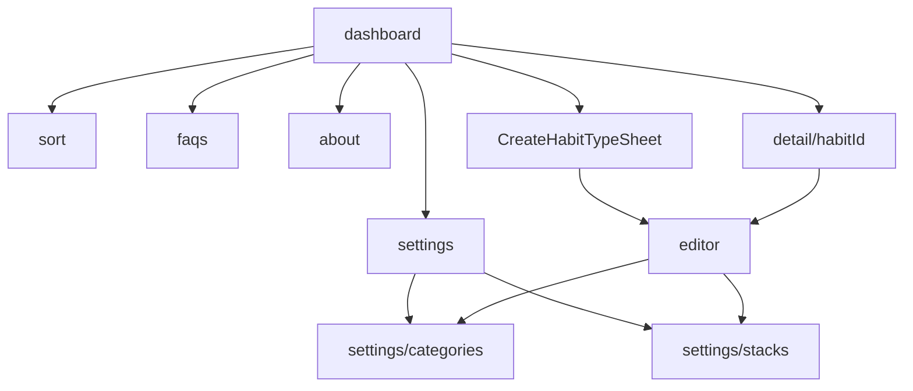

# Kinetic Routines — Product & Technical Specification

**Analyzed codebase:** `d:\Projects\kinetiq` (Kotlin Android, single module `:app`)  
**Note:** Path `/habit-app-kotlin` was not found; this SPEC documents the kinetiq workspace as opened.  
**Code namespace:** `com.example` · **Play applicationId:** `com.kinetiq.app`  
**In-app brand:** "Routines" (`app/src/main/res/values/strings.xml`) · Product name in docs/README: Kinetic Routines  
**Version:** `versionCode = 1`, `versionName = "1.0.0"` (`app/build.gradle.kts`)  
**Privacy:** Front-end only — no accounts, servers, sync, or network permission. Room + DataStore on device; optional passphrase-encrypted user export.

This document is derived from source. Paths are relative to the repo root unless absolute Windows paths are shown.

**Stable IDs:** Every feature/rule/component has an ID (`NAV-*`, `UI-*`, `DATA-*`, `PERS-*`, `LOGIC-*`, `NOTIF-*`, `SET-*`, `THEME-*`, `AND-*`, `OQ-*`). Use these for cross-doc / iOS parity tracking.  
**Theme values:** See companion [THEME_TOKENS.md](THEME_TOKENS.md) for hex colors, typography metrics, shapes, spacing, elevation, and the full icon catalog.

---

## Table of contents

1. [Screens and navigation](#1-screens-and-navigation)
2. [UI details per screen](#2-ui-details-per-screen)
3. [Data models](#3-data-models)
4. [Persistence](#4-persistence)
5. [Business logic](#5-business-logic)
6. [Notifications](#6-notifications)
7. [Settings, theming, icons, strings](#7-settings-theming-icons-strings)
8. [Permissions, background work, Android-specific](#8-permissions-background-work-android-specific)
9. [Open questions](#9-open-questions)

---

## 1. Screens and navigation

### 1.1 Host

| ID | Item | Detail | Reference |
|----|------|--------|-----------|
| NAV-1 | Activity | `MainActivity` | `app/src/main/java/com/example/MainActivity.kt` |
| NAV-2 | Edge-to-edge | `enableEdgeToEdge()` | same |
| NAV-3 | Theme host | `KineticRoutinesTheme(themeMode)` from ViewModel | same; `ui/theme/Theme.kt` |
| NAV-4 | Nav host | Navigation Compose `NavHost` | `MainActivity.kt` |
| NAV-5 | Start destination | `"dashboard"` | `MainActivity.kt` |
| NAV-6 | ViewModel | Single `KineticViewModel` via `Factory(AppContainer)` | `ui/viewmodel/KineticViewModel.kt`, `di/AppContainer.kt` |
| NAV-7 | Compose URI deep links | **None** | — |
| NAV-8 | Intent deep link | Extra `selected_habit_id` (Long) | Manifest has no VIEW filter; see §6 |

### 1.2 Route table

| ID | Route | Arguments | Screen composable | File |
|----|-------|-----------|-------------------|------|
| NAV-9 | `dashboard` | — | `KineticDashboardScreen` | `ui/screens/KineticDashboardScreen.kt` |
| NAV-10 | `sort` | — | `HabitSortScreen` | `ui/screens/HabitSortScreen.kt` |
| NAV-11 | `faqs` | — | `FaqScreen` | `ui/screens/FaqScreen.kt` |
| NAV-12 | `about` | — | `AboutScreen` | `ui/screens/AboutScreen.kt` |
| NAV-13 | `detail/{habitId}` | `habitId: Long` | `HabitDetailAnalyticsScreen` | `ui/screens/HabitDetailAnalyticsScreen.kt` |
| NAV-14 | `editor?habitId={habitId}` | `habitId: Long`, default `-1L` | `HabitEditorSheet` (full-screen; name historical) | `ui/screens/HabitEditorSheet.kt` |
| NAV-15 | `settings` | — | `SettingsScreen` | `ui/screens/SettingsScreen.kt` |
| NAV-16 | `settings/categories` | — | `CategoryManageScreen` | `ui/screens/CategoryManageScreen.kt` |
| NAV-17 | `settings/stacks` | — | `StackManageScreen` | `ui/screens/StackManageScreen.kt` |

### 1.3 Entry points and transitions

| ID | From | Transition |
|----|------|------------|
| NAV-18 | dashboard view menu | Flat/Stack, Card/Table layout toggles; navigate `sort` |
| NAV-19 | dashboard bell | `NotificationSettingsDialog` (overlay, not a route) |
| NAV-20 | dashboard hamburger | → `settings` \| `faqs` \| `about` |
| NAV-21 | habit card/row tap | → `detail/{id}` |
| NAV-22 | habit overflow Edit | → `editor?habitId={id}` |
| NAV-23 | habit overflow Archive / Delete | archive snackbar or delete dialog |
| NAV-24 | FAB | → CreateHabitTypeSheet → `beginCreateHabit` → `editor` (`habitId=-1`) |
| NAV-25 | notification deep link | when habit resolved on dashboard → `detail/{id}` |
| NAV-26 | detail back | `popBackStack` + `closeHabitDetail` |
| NAV-27 | detail edit | → `editor?habitId={id}` |
| NAV-28 | editor create guard | `id≤0` requires `createDraft`; else `popBackStack` |
| NAV-29 | editor edit loading | `id>0` and habit null → spinner until found |
| NAV-30 | editor Manage links | → `settings/categories` \| `settings/stacks` |
| NAV-31 | editor save/dismiss | `popBackStack` (+ `clearCreateDraft` via `closeEditor`) |
| NAV-32 | editor delete/archive | `popBackStack("dashboard", inclusive=false)` |
| NAV-33 | settings | → `settings/categories` \| `settings/stacks` |

**Deep link flow** (NAV-8 / NAV-25) — `MainActivity.kt`, `HabitNotificationReceiver.kt`, `KineticViewModel.kt`:

| ID | Step |
|----|------|
| NAV-34 | Notification content tap builds `MainActivity` Intent with `selected_habit_id` if `habitId > 0` |
| NAV-35 | `handleDeepLink` / `onNewIntent` → `onNotificationDeepLink(id)` |
| NAV-36 | When habit in `allHabits`, ViewModel opens detail selection |
| NAV-37 | Dashboard `LaunchedEffect` navigates to `detail/{id}` when on dashboard |
| NAV-38 | Digest tap uses `habitId = -1` → no detail deep link |

### 1.4 Create-habit type lock flow (pre-editor)

| ID | Step | UI | Outcome | Reference |
|----|------|-----|---------|-----------|
| NAV-39 | FAB | Opens sheet | `showCreateSheet = true` | `KineticDashboardScreen.kt` |
| NAV-40 | Step 1 | Check-in vs Measurable | `EditorKind` | `ui/components/CreateHabitTypeSheet.kt` |
| NAV-41 | Step 2a | Check-in question (required) | `HabitCreateDraft(YES_NO, question)` | `KineticViewModel` |
| NAV-42 | Step 2b | Amount / Count / Timer | `NUMERIC` / `TALLY` / `TIMER` | `domain/HabitEditorModality.kt` |
| NAV-43 | Dismiss sheet | Cancel | No draft, stay on Home | — |
| NAV-44 | Continue | Navigate editor | Locked modality + optional question prefill | `MainActivity.kt` |
| NAV-45 | Rule | Modality immutable after create | UI + `HabitRepository.saveHabit` | — |

---

## 2. UI details per screen

### 2.1 Dashboard — `KineticDashboardScreen` (NAV-9)

**File:** `app/src/main/java/com/example/ui/screens/KineticDashboardScreen.kt`

| ID | Aspect | Detail |
|----|--------|--------|
| UI-DASH-1 | Layout | `Scaffold` + `LazyColumn`; TopAppBar brand "Routines" (Fraunces); FAB `+` |
| UI-DASH-2 | List Card mode | `HabitCard` |
| UI-DASH-3 | List Table mode | `HabitTableDateHeader` + `HabitTableRow` |
| UI-DASH-4 | Flat vs Stack | Group by `routineStackId` when stack view on |
| UI-DASH-5 | Category chips | Filter by `categoryId`; "All" + counts |
| UI-DASH-6 | Hero | `InAppNudgeStrip` if `showHeroSection` and nudges non-empty |
| UI-DASH-7 | Activity chart | `HabitActivityChart` if `showActivityChart` and cards non-empty |
| UI-DASH-8 | Day strip length | 9 days (`CARD_DAY_STRIP_DAYS`) |
| UI-DASH-9 | Day tap | `handleDayClick` |
| UI-DASH-10 | Day long-press | `QuickLogDialog` |
| UI-DASH-11 | Timer overlay | `ActiveTimerDialog` when `activeTimerHabit` set |

| ID | State | Behavior |
|----|-------|----------|
| UI-DASH-12 | Empty habits | "No habits yet" / create hint |
| UI-DASH-13 | Empty filter | No habits in category message |
| UI-DASH-14 | Loading | No full-screen loader (flows default empty) |
| UI-DASH-15 | Error | No dedicated error scaffold |

| ID | Overlay | Trigger |
|----|---------|---------|
| UI-DASH-16 | `CreateHabitTypeSheet` | FAB |
| UI-DASH-17 | `QuickLogDialog` | Long-press / NUMERIC re-tap |
| UI-DASH-18 | `ActiveTimerDialog` | TIMER flow |
| UI-DASH-19 | `NotificationSettingsDialog` | Bell |
| UI-DASH-20 | Delete confirm | Overflow Delete |
| UI-DASH-21 | Snackbar | "Habit archived" + Undo |

| ID | Menu / motion | Detail |
|----|---------------|--------|
| UI-DASH-22 | View menu | Flat/Stack, Card/Table, Sort |
| UI-DASH-23 | Main menu | Settings, FAQs, About |
| UI-DASH-24 | Habit overflow | Edit, Archive, Delete |
| UI-DASH-25 | Hero animation | Auto-advance ~8s (`InAppNudgeBanner.kt`) |
| UI-DASH-26 | Chart toggle | Activity ↔ Momentum |

### 2.2 Habit detail — `HabitDetailAnalyticsScreen` (NAV-13)

**File:** `ui/screens/HabitDetailAnalyticsScreen.kt`

| ID | Section | Content |
|----|---------|---------|
| UI-DETAIL-1 | Top bar | Back, title, cue, edit |
| UI-DETAIL-2 | Gauge | `KineticGauge` (momentum %, trajectory) |
| UI-DETAIL-3 | Metrics | Current streak, best streak, target, floor |
| UI-DETAIL-4 | Heatmap | `HeatmapMatrix` (~20 weeks / 140 cells) |
| UI-DETAIL-5 | Weekly bars | `WeeklyBarChart` (Mon–Sun rates) |
| UI-DETAIL-6 | Friction | Tag counts if any |
| UI-DETAIL-7 | Activity list | Last 15 log rows; delete per day |
| UI-DETAIL-8 | Loading | Spinner until habit id matches (`MainActivity`) |
| UI-DETAIL-9 | Empty logs | "No recorded logs yet for this habit." |

### 2.3 Habit editor — `HabitEditorSheet` (NAV-14)

**File:** `ui/screens/HabitEditorSheet.kt`

| ID | Block | Fields / rules |
|----|-------|----------------|
| UI-EDIT-1 | Title | Required (`HabitValidator`) |
| UI-EDIT-2 | Check-in question | Only `YES_NO`; required for save; reminder copy |
| UI-EDIT-3 | Locked type | Read-only `modalityDisplayLabel` |
| UI-EDIT-4 | Measurable fields | Target, floor, unit |
| UI-EDIT-5 | Details | Cue, description (collapsible) |
| UI-EDIT-6 | Organize | Category/stack chips; Manage links |
| UI-EDIT-7 | Appearance | Color presets / HSV dialog; icon catalog |
| UI-EDIT-8 | Schedule | Rest mask, reminder toggle, time picker, reminder mask |
| UI-EDIT-9 | Edit-only actions | Archive, Delete |
| UI-EDIT-10 | Dialogs | TimePicker; CustomColorDialog; Discard; Delete confirm |
| UI-EDIT-11 | Back when dirty | Discard confirm; else dismiss (create → Home) |

### 2.4 Settings — `SettingsScreen` (NAV-15)

**File:** `ui/screens/SettingsScreen.kt`

| ID | Section | Content |
|----|---------|---------|
| UI-SET-1 | Appearance | Theme mode |
| UI-SET-2 | Home | Hero / activity chart toggles |
| UI-SET-3 | Library | Nav to categories / stacks |
| UI-SET-4 | Habits | Rest shield, default floor %, week start |
| UI-SET-5 | Notifications | Digest toggle/hour, test, exact-alarm hint |
| UI-SET-6 | Data | Export/import backup, sample habit, clear all activity |
| UI-SET-7 | Archived | Restore list |
| UI-SET-8 | Footer | Version |
| UI-SET-9 | Feedback | Toasts for test/sample/clear; inline backup status |
| UI-SET-10 | Clear confirm | AlertDialog before wipe logs |

### 2.5 Category / Stack manage

| ID | Screen | File | UI |
|----|--------|------|-----|
| UI-CAT-1 | Categories | `CategoryManageScreen.kt` | List, reorder, usage, edit/delete, FAB |
| UI-CAT-2 | Categories empty | — | Empty copy when no categories |
| UI-STACK-1 | Stacks | `StackManageScreen.kt` | Name, description, usage, edit/delete, FAB |
| UI-STACK-2 | Stacks empty | — | Empty copy when no stacks |

### 2.6 Sort — `HabitSortScreen` (NAV-10)

| ID | Detail |
|----|--------|
| UI-SORT-1 | Manual vs Momentum chips |
| UI-SORT-2 | Drag reorder when MANUAL |
| UI-SORT-3 | Ranked % list for momentum modes |
| UI-SORT-4 | Empty: "No habits to sort" |

### 2.7 FAQs / About

| ID | Screen | File | Content |
|----|--------|------|---------|
| UI-FAQ-1 | FAQ | `FaqScreen.kt` | Accordion; `FAQ_ITEMS` in same file |
| UI-ABOUT-1 | About | `AboutScreen.kt` | Brand, tagline, version, features, privacy, credit |

### 2.8 Shared components (`ui/components/`)

| ID | File | Role |
|----|------|------|
| UI-COMP-1 | `CreateHabitTypeSheet.kt` | ModalBottomSheet create type flow |
| UI-COMP-2 | `HabitCard.kt` | Card, day cells, momentum badge, overflow |
| UI-COMP-3 | `HabitTable.kt` | Compact table layout |
| UI-COMP-4 | `HabitActivityChart.kt` | Home Activity / Momentum chart; dismissible |
| UI-COMP-5 | `InAppNudgeBanner.kt` | Hero slideshow |
| UI-COMP-6 | `QuickLogDialog.kt` | Target/floor/custom/timer/friction/clear |
| UI-COMP-7 | `ActiveTimerDialog.kt` | Focus timer |
| UI-COMP-8 | `NotificationSettingsDialog.kt` | Enable check / Open Settings / Send Test |
| UI-COMP-9 | `KineticGauge.kt` | Detail momentum arc |
| UI-COMP-10 | `HeatmapMatrix.kt` | Heatmap |
| UI-COMP-11 | `WeeklyBarChart.kt` | DOW rates |
| UI-COMP-12 | Friction tags | Fixed: "Low Energy", "Time Crunch", "Travel / Away", "Distraction" |

---

## 3. Data models

### 3.1 `Habit` / `HabitEntity`

**File:** `app/src/main/java/com/example/data/model/Habit.kt` · **Table:** `habits`

| ID | Field | Type | Default | Constraints / notes |
|----|-------|------|---------|---------------------|
| DATA-HABIT-1 | `id` | `Long` | `0` | Auto PK |
| DATA-HABIT-2 | `title` | `String` | required | Display name; non-blank |
| DATA-HABIT-3 | `description` | `String` | `""` | |
| DATA-HABIT-4 | `cueTrigger` | `String` | `""` | Cue; shown on cards |
| DATA-HABIT-5 | `checkInQuestion` | `String` | `""` | Check-in reminder question (not title) |
| DATA-HABIT-6 | `modality` | `HabitModality` | `YES_NO` | **Immutable after insert** |
| DATA-HABIT-7 | `targetValue` | `Double` | `1.0` | > 0 |
| DATA-HABIT-8 | `floorValue` | `Double?` | `null` | Else effective floor = 25% of target when logging |
| DATA-HABIT-9 | `unit` | `String` | `""` | Falls back to modality `defaultUnit` |
| DATA-HABIT-10 | `categoryId` | `Long?` | `null` | FK categories, ON DELETE SET NULL |
| DATA-HABIT-11 | `colorHex` | `String` | `"#10B981"` | |
| DATA-HABIT-12 | `iconName` | `String` | `"Sparkles"` | Catalog string; Sparkles not in catalog → Star fallback |
| DATA-HABIT-13 | `reminderHour` | `Int?` | `null` | Null → no reminder |
| DATA-HABIT-14 | `reminderMinute` | `Int?` | `null` | |
| DATA-HABIT-15 | `reminderDaysMask` | `Int` | `127` | Bits Mon…Sun; 127 = all |
| DATA-HABIT-16 | `restDaysMask` | `Int` | `0` | Rest Shield days |
| DATA-HABIT-17 | `routineStackId` | `Long?` | `null` | FK stacks, ON DELETE SET NULL |
| DATA-HABIT-18 | `orderIndex` | `Int` | `0` | Manual sort |
| DATA-HABIT-19 | `isArchived` | `Boolean` | `false` | Soft hide |
| DATA-HABIT-20 | `createdAt` | `Long` | now | Epoch ms |
| DATA-HABIT-21 | Helpers | — | — | `isRestDay`, `isReminderEnabledForDay` |

### 3.2 `LogEntry` / `HabitRecordEntity`

**File:** `data/model/LogEntry.kt` · **Table:** `log_entries`

| ID | Field | Type | Default | Notes |
|----|-------|------|---------|-------|
| DATA-LOG-1 | `id` | `Long` | `0` | Auto PK |
| DATA-LOG-2 | `habitId` | `Long` | required | FK habits, ON DELETE CASCADE |
| DATA-LOG-3 | `dateString` | `String` | | `yyyy-MM-dd` |
| DATA-LOG-4 | `isCompleted` | `Boolean` | `false` | Target met |
| DATA-LOG-5 | `isFloorSustained` | `Boolean` | `false` | Floor without target |
| DATA-LOG-6 | `numericValue` | `Double` | `0.0` | Amount / minutes / tally |
| DATA-LOG-7 | `durationSeconds` | `Int` | `0` | TIMER |
| DATA-LOG-8 | `tallyCount` | `Int` | `0` | TALLY |
| DATA-LOG-9 | `frictionTag` | `String?` | `null` | |
| DATA-LOG-10 | `notes` | `String` | `""` | |
| DATA-LOG-11 | `recordedAt` | `Long` | now | |
| DATA-LOG-12 | Unique index | — | — | `(habitId, dateString)` one log/day |

### 3.3–3.5 Other entities

| ID | Entity | File | Fields / notes |
|----|--------|------|----------------|
| DATA-CAT-1 | `Category` | `Category.kt` | `id`, `name`, `colorHex` `#10B981`, `iconName` `Folder`, `orderIndex` `0` |
| DATA-STACK-1 | `RoutineStackEntity` | `RoutineStackEntity.kt` | `id`, `name`, `description` `""`, `iconName` `Bolt`, `colorHex` `#8B5CF6` |
| DATA-MOD-1 | `YES_NO` | `HabitModality.kt` | display "Yes / No", unit `""` |
| DATA-MOD-2 | `NUMERIC` | same | "Numeric Goal", `"units"` |
| DATA-MOD-3 | `TIMER` | same | "Duration Timer", `"mins"` |
| DATA-MOD-4 | `TALLY` | same | "Daily Tally", `"times"` |

### 3.6 Editor / draft types (non-Room)

| ID | Type | File | Role |
|----|------|------|------|
| DATA-DRAFT-1 | `EditorKind` | `HabitEditorModality.kt` | CHECK_IN / MEASURABLE |
| DATA-DRAFT-2 | `MeasurableLogStyle` | same | AMOUNT→NUMERIC, COUNT→TALLY, TIMER→TIMER |
| DATA-DRAFT-3 | `HabitCreateDraft` | `KineticViewModel.kt` | `modality` + `initialCheckInQuestion` |
| DATA-DRAFT-4 | `HabitCardUi` | `KineticViewModel.kt` | Dashboard card projection |
| DATA-DRAFT-5 | `KineticSettings` | `SettingsRepository.kt` | Preference aggregate |
| DATA-DRAFT-6 | Backup DTOs | `BackupManager.kt` | `BackupPayload` schemaVersion **1** |

### 3.7 Seeded library defaults

| ID | Rule | Reference |
|----|------|-----------|
| DATA-LIB-1 | 8 categories + 3 stacks seeded once | `LibraryDefaults.kt`, Application seed flag |
| DATA-LIB-2 | Habits not auto-seeded | — |
| DATA-LIB-3 | Sample habit "Mindful Breathwork" TIMER 5/1 | `HabitRepository.loadSampleHabit()` |

---

## 4. Persistence

### 4.1 Room

| ID | Item | Value | Reference |
|----|------|-------|-----------|
| PERS-1 | Database class | `KineticDatabase` | `data/db/KineticDatabase.kt` |
| PERS-2 | Version | **4** | same |
| PERS-3 | File name | `"orbit_habit_database"` (legacy) | `di/AppContainer.kt` |
| PERS-4 | Schema export | `app/schemas/.../{3,4}.json` | KSP `room.schemaLocation` |
| PERS-5 | Converters | `HabitModality` ↔ name | `Converters` |
| PERS-6 | Migrations list | `MIGRATION_2_3`, `MIGRATION_3_4` | same |
| PERS-7 | FK category | SET NULL | habits.categoryId |
| PERS-8 | FK stack | SET NULL | habits.routineStackId |
| PERS-9 | FK logs | CASCADE | log_entries.habitId |
| PERS-10 | Indexes | categoryId, routineStackId; unique habitId+dateString | schema |

### 4.2 Migrations

| ID | Migration | Summary |
|----|-----------|---------|
| PERS-11 | 2 → 3 | Backfill categories from legacy text; recreate habits + FK logs |
| PERS-12 | 3 → 4 | Recreate habits + `checkInQuestion`; FK off during swap |

### 4.3 DAOs

| ID | DAO | File | Notes |
|----|-----|------|-------|
| PERS-13 | `HabitDao` | `HabitDao.kt` | Habits + stacks; order by orderIndex, id |
| PERS-14 | `LogEntryDao` | `LogEntryDao.kt` | Windowed queries; insertOrUpdate REPLACE |
| PERS-15 | `CategoryDao` | `CategoryDao.kt` | CRUD + reorder |
| PERS-16 | Rule | Habit edit uses UPDATE never INSERT REPLACE | `HabitRepository.saveHabit` |

### 4.4 DataStore

**File:** `SettingsRepository.kt` · Store `"kinetiq_settings"`

| ID | Key | Type | Field | Default |
|----|-----|------|-------|---------|
| PERS-17 | `theme_mode` | string | `themeMode` | `ThemeMode.DARK` |
| PERS-18 | `week_starts_monday` | boolean | `weekStartsOnMonday` | `true` |
| PERS-19 | `default_floor_percent` | int | `defaultFloorPercent` | `25` (1–100) |
| PERS-20 | `rest_shield_enabled` | boolean | `restShieldEnabled` | `true` |
| PERS-21 | `digest_enabled` | boolean | `dailyEveningDigestEnabled` | `true` |
| PERS-22 | `digest_hour` | int | `dailyEveningDigestHour` | `21` |
| PERS-23 | `show_hero_section` | boolean | `showHeroSection` | `true` |
| PERS-24 | `show_activity_chart` | boolean | `showActivityChart` | `true` |
| PERS-25 | `dismissed_nudges` | stringSet | `dismissedNudgeIds` | empty; `"id@yyyy-MM-dd"` |
| PERS-26 | `habit_sort_mode` | string | `sortMode` | `MANUAL` |
| PERS-27 | `habit_list_layout` | string | `habitListLayout` | `CARD` |
| PERS-28 | `library_defaults_seeded` | boolean | `libraryDefaultsSeeded` | `false` |
| PERS-29 | SharedPreferences API | — | **Not used** | DataStore only |

### 4.5 Backup

| ID | Item | Detail |
|----|------|--------|
| PERS-30 | Format | `kinetiq-backup`, envelope version 1 |
| PERS-31 | Payload schema | `CURRENT_SCHEMA = 1` |
| PERS-32 | Crypto | AES/GCM, PBKDF2-HMAC-SHA256, 120k iter, 256-bit, 16B salt, 12B IV |
| PERS-33 | Passphrase | Min 8 chars |
| PERS-34 | Import | `replaceAllData`; validate log→habit |
| PERS-35 | checkInQuestion | Optional JSON default `""` |
| PERS-36 | OS backup | `allowBackup=false` + exclusion XML |

### 4.6 Query windows

| ID | Window | Days | Use |
|----|--------|------|-----|
| PERS-37 | Dashboard | 14 | Day strips |
| PERS-38 | Momentum | 91 | EMA source |
| PERS-39 | Detail | 400 | Analytics |
| PERS-40 | Card strip | 9 | UI |

---

## 5. Business logic

| ID | Rule |
|----|------|
| LOGIC-1 | No RRULE / every-N-days frequency; obligation = daily except rest mask |

### 5.1 Dates and timezone

| ID | Piece | Behavior |
|----|-------|----------|
| LOGIC-DATE-1 | Date keys | ISO `yyyy-MM-dd` via `DateCodec` |
| LOGIC-DATE-2 | Today | `KineticClock.today()` / `SystemKineticClock` local |
| LOGIC-DATE-3 | createdAt → date | Instant → system ZoneId → LocalDate |
| LOGIC-DATE-4 | Tests | `FixedKineticClock` |

### 5.2 Completion / logging

| ID | Modality / method | Rule |
|----|-------------------|------|
| LOGIC-LOG-1 | YES_NO | Toggle complete / clear |
| LOGIC-LOG-2 | TALLY | +1 per tap; complete when ≥ target |
| LOGIC-LOG-3 | TIMER | Timer / duration; seconds accumulate; numeric = minutes |
| LOGIC-LOG-4 | NUMERIC | First tap → target; re-tap → quick log |
| LOGIC-LOG-5 | `setCompletedForDate` | Idempotent; notifications never un-log |
| LOGIC-LOG-6 | `logFloorSustainForDate` | No-op if already completed |
| LOGIC-LOG-7 | `logNumericProgress` | ≤0 deletes; else completed/floor thresholds |
| LOGIC-LOG-8 | `logDurationSeconds` | ≤0 no-op; **adds** seconds |
| LOGIC-LOG-9 | `logFrictionTag` | Upsert tag/notes; keep completion |
| LOGIC-LOG-10 | Effective floor | `floorValue ?: targetValue * 0.25` |

### 5.3 Rest Shield

| ID | Rule |
|----|------|
| LOGIC-REST-1 | Per-habit `restDaysMask` + global `restShieldEnabled` |
| LOGIC-REST-2 | Rest + no log → Momentum frozen; streak preserved |
| LOGIC-REST-3 | Log on rest day counts normally |
| LOGIC-REST-4 | Reminders skip rest days |

### 5.4 Momentum (EMA)

| ID | Rule |
|----|------|
| LOGIC-MOM-1 | `strength := 0.93*strength + 0.07*v` |
| LOGIC-MOM-2 | v = 1.0 target / 0.65 floor / 0.0 miss |
| LOGIC-MOM-3 | Window last 90 days from max(today−90, start) |
| LOGIC-MOM-4 | start = min(created, earliest log) |
| LOGIC-MOM-5 | Pre-start days never penalize |
| LOGIC-MOM-6 | Display round 0–100% |
| LOGIC-MOM-7 | Over-target does not raise v above 1.0 |
| LOGIC-MOM-8 | Trajectory: Accelerating / Rebuilding / Steady High (≥70) / Forming Routine |
| LOGIC-MOM-9 | `AnalyticsCache` LRU 32 |

### 5.5 Streaks

| ID | Rule |
|----|------|
| LOGIC-STREAK-1 | Current: walk back; rest skips; miss breaks |
| LOGIC-STREAK-2 | If today incomplete and not rest, start from yesterday |
| LOGIC-STREAK-3 | Best: scan ~180 days; same rest/miss rules |

### 5.6 Heatmap / DOW / friction

| ID | Rule |
|----|------|
| LOGIC-HEAT-1 | ~140 cells; FULL / FLOOR / REST / MISSED / NONE |
| LOGIC-HEAT-2 | DOW rates last 60 days |
| LOGIC-HEAT-3 | Friction = counts of non-null tags |

### 5.7 Validation / sort / nudges

| ID | Rule |
|----|------|
| LOGIC-VAL-1 | Title non-blank; target > 0 finite; floor ≥0 and ≤ target |
| LOGIC-VAL-2 | YES_NO requires check-in question in editor |
| LOGIC-SORT-1 | MANUAL by orderIndex; momentum by % then orderIndex |
| LOGIC-NUDGE-1 | In-app hero slides; dismiss `"id@yyyy-MM-dd"` |

---

## 6. Notifications

### 6.1 Channels

| ID | Channel ID | Name | Importance | Use |
|----|------------|------|------------|-----|
| NOTIF-1 | `orbit_reminders_channel` | Habit Reminders | HIGH (+ vibrate) | Reminders + action feedback |
| NOTIF-2 | `orbit_nudges_channel` | Smart Nudges & Momentum | DEFAULT | Evening digest |
| NOTIF-3 | Channel create | On Application.onCreate | — | `HabitNotificationScheduler` |

### 6.2 Habit reminders

| ID | Item | Detail |
|----|------|--------|
| NOTIF-4 | Schedule | After save if hour+minute and not archived |
| NOTIF-5 | Next fire | `NextReminderCalculator.nextFire` (≤8 day scan; skip rest) |
| NOTIF-6 | Cancel | Archive, delete, or clear reminder fields |
| NOTIF-7 | Repeat | On fire, re-arm next occurrence |
| NOTIF-8 | Boot / TZ / replace | `BootReceiver` re-schedules all + digest |

### 6.3 Content and actions

| ID | Case / action | Detail |
|----|---------------|--------|
| NOTIF-9 | Check-in content | Title = question; body = habit title |
| NOTIF-10 | Other content | Title = `Habit Reminder: {title}`; body = cue or default |
| NOTIF-11 | Action Done | Complete target for today |
| NOTIF-12 | Action Floor | If floorVal > 0 |
| NOTIF-13 | Action Snooze | +15 minutes |
| NOTIF-14 | Tap | Open app ± `selected_habit_id` |

### 6.4 Evening digest

| ID | Detail |
|----|--------|
| NOTIF-15 | Default enabled, hour 21 |
| NOTIF-16 | `nextDigestFire` today or tomorrow |
| NOTIF-17 | Copy: Evening Momentum Review |
| NOTIF-18 | Notification id `880001` |

### 6.5 Exact alarms / permissions / codes

| ID | Detail |
|----|--------|
| NOTIF-19 | `SCHEDULE_EXACT_ALARM`; exact if allowed else inexact fallback |
| NOTIF-20 | Settings warning when exact unavailable |
| NOTIF-21 | `POST_NOTIFICATIONS`; UX via system settings dialog (no runtime launcher) |
| NOTIF-22 | `PendingIntentCodes` salted per habit |
| NOTIF-23 | Quirk: restore/undoArchive does not reschedule until save or boot |

---

## 7. Settings, theming, icons, strings

### 7.1 Settings surface

| ID | Detail |
|----|--------|
| SET-1 | UI covered by UI-SET-*; keys by PERS-17…PERS-28 |
| SET-2 | `ThemeMode` DARK/LIGHT/SYSTEM |
| SET-3 | `HabitSortMode` MANUAL / MOMENTUM_DESCENDING / MOMENTUM_ASCENDING |
| SET-4 | `HabitListLayout` CARD / TABLE |

### 7.2 Theming

| ID | Detail | File |
|----|--------|------|
| THEME-1 | Material3 light/dark schemes + system bars | `Theme.kt` — full hex in THEME_TOKENS.md |
| THEME-2 | Brand/semantic palette | `Color.kt` |
| THEME-3 | Plus Jakarta Sans + Fraunces | `Type.kt` |
| THEME-4 | 16 habit presets; default `#10B981` | `HabitColor.kt` |
| THEME-5 | Habit icon catalog (37 names) | `HabitIcons.kt` |
| THEME-6 | Default preference DARK | DataStore |
| THEME-7 | XML shell theme | `res/values/themes.xml` |

### 7.3 Strings / localization

| ID | Finding |
|----|---------|
| SET-5 | `strings.xml` only `app_name` = "Routines" |
| SET-6 | English only; no `values-xx/` |
| SET-7 | Compose copy hardcoded |
| SET-8 | `supportsRtl=true`; no translated resources |

### 7.4 Icons

| ID | Detail |
|----|--------|
| SET-9 | Launcher `@mipmap/ic_launcher` / round |
| SET-10 | Habit `iconName` → catalog or Star |
| SET-11 | Notification small icon `R.mipmap.ic_launcher` |

---

## 8. Permissions, background work, Android-specific

### 8.1 Manifest permissions

| ID | Permission |
|----|------------|
| AND-1 | `POST_NOTIFICATIONS` |
| AND-2 | `VIBRATE` |
| AND-3 | `SCHEDULE_EXACT_ALARM` |
| AND-4 | `RECEIVE_BOOT_COMPLETED` |
| AND-5 | No INTERNET / WAKE_LOCK / USE_EXACT_ALARM |

### 8.2 Components / background

| ID | Detail |
|----|--------|
| AND-6 | `MainActivity` MAIN/LAUNCHER |
| AND-7 | `HabitNotificationReceiver` exported=false |
| AND-8 | `BootReceiver` BOOT / TIMEZONE / MY_PACKAGE_REPLACED |
| AND-9 | AlarmManager only (no WorkManager for habits) |
| AND-10 | Receiver `goAsync` + coroutine |
| AND-11 | No sync workers |

### 8.3 Build / platform

| ID | Item | Value |
|----|------|-------|
| AND-12 | minSdk | 24 |
| AND-13 | targetSdk / compileSdk | 36 |
| AND-14 | Desugar java.time | yes |
| AND-15 | Manual DI `AppContainer` | no Hilt |
| AND-16 | R8 minify + shrink release | yes |
| AND-17 | CI lint + unit tests + assembleDebug | `.github/workflows/ci.yml` |

### 8.4 No direct iOS equivalent

| ID | Android piece |
|----|---------------|
| AND-18 | Exact/inexact AlarmManager |
| AND-19 | BootReceiver / TZ / package replace |
| AND-20 | Notification channels + BroadcastReceiver actions |
| AND-21 | Room + KSP migrations |
| AND-22 | DataStore Preferences |
| AND-23 | allowBackup=false + encrypted export |
| AND-24 | Edge-to-edge / WindowInsets |
| AND-25 | applicationId vs namespace split |
| AND-26 | R8 / ProGuard Moshi-Room keeps |
| AND-27 | Robolectric tests |

---

## 9. Open questions

| ID | Question |
|----|----------|
| OQ-1 | Path `/habit-app-kotlin` missing — confirm kinetiq is the target |
| OQ-2 | No RRULE frequency — keep daily+rest model on iOS? |
| OQ-3 | Default theme DARK vs SYSTEM intentional? |
| OQ-4 | Archive restore without reminder re-arm OK? |
| OQ-5 | Can check-in question be cleared after create? |
| OQ-6 | YES_NO often has no Floor notification action — intended? |
| OQ-7 | Nudges channel name vs in-app hero naming |
| OQ-8 | Heatmap MISSED vs NONE color semantics for port |
| OQ-9 | Trajectory ~8 samples vs docs "7 days" |
| OQ-10 | Backup schemaVersion 1 while Room v4 — bump policy? |
| OQ-11 | metadata.json Gemini capability stale? |
| OQ-12 | Unused version-catalog deps out of iOS scope? |
| OQ-13 | Sunday-first locales vs Mon-bit-0 masks |
| OQ-14 | Process death mid-create (lost draft) acceptable? |
| OQ-15 | Timer across midnight / TZ change |
| OQ-16 | Concurrent notification + in-app log races |
| OQ-17 | ProGuard keep for future Moshi types |
| OQ-18 | Full TalkBack a11y matrix not audited |
| OQ-19 | Widgets / Wear / shortcuts out of iOS v1? |
| OQ-20 | Display name: Routines vs Kinetic Routines |
| OQ-21 | Habit default icon `Sparkles` not in catalog (Star fallback) vs editor `SelfImprovement` |

---

## Appendix A — Primary file index

| Area | Paths |
|------|-------|
| Entry | `KineticRoutinesApplication.kt`, `MainActivity.kt`, `di/AppContainer.kt` |
| Models | `data/model/*.kt` |
| DB | `data/db/KineticDatabase.kt`, `*Dao.kt`, `app/schemas/...` |
| Repos | `data/repository/*.kt`, `data/backup/BackupManager.kt` |
| Domain | `domain/analytics/*`, `domain/time/KineticClock.kt`, `domain/validation/HabitValidator.kt`, `domain/HabitEditorModality.kt` |
| Notifications | `notification/*.kt` |
| UI | `ui/screens/*.kt`, `ui/components/*.kt`, `ui/theme/*.kt`, `ui/viewmodel/KineticViewModel.kt` |
| Theme tokens | [THEME_TOKENS.md](THEME_TOKENS.md) |
| Docs | `README.md`, `docs/KINETIC_MOMENTUM.md`, `docs/RELEASE_CHECKLIST.md` |
| Tests | `app/src/test/java/com/example/*.kt` |

## Appendix B — ID prefix legend

| Prefix | Scope |
|--------|-------|
| NAV-* | Navigation host, routes, transitions |
| UI-DASH-* / UI-DETAIL-* / UI-EDIT-* / UI-SET-* / UI-CAT-* / UI-STACK-* / UI-SORT-* / UI-FAQ-* / UI-ABOUT-* / UI-COMP-* | Screens & components |
| DATA-* | Models, modalities, library seeds |
| PERS-* | Room, DataStore, backup, windows |
| LOGIC-* | Dates, logging, rest, momentum, streaks, validation |
| NOTIF-* | Channels, scheduling, actions |
| SET-* / THEME-* | Preferences & theme pointers |
| AND-* | Android-specific / porting |
| OQ-* | Open questions |

## Appendix C — Navigation diagram

---

*End of SPEC.md — IDs assigned for cross-reference; theme literals live in THEME_TOKENS.md.*
